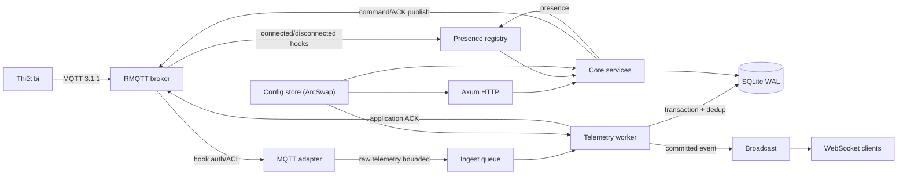

# 01 — Stack và kiến trúc đã chốt

- Trạng thái: **CHỐT cho MVP**. Thay đổi phải có ADR mới trong tài liệu này.
- Mục tiêu: một binary `iot-server`, một process, cấu hình `conf.toml`, SQLite mặc định, không cần broker hay Node.js bên ngoài.

## 1. Nguyên tắc kiến trúc

1. **Modular monolith**: module nội bộ tách trách nhiệm, không microservice.
2. **Core không phụ thuộc adapter**: `core` không import `axum`, `rmqtt`, `sqlx`.
3. **Mọi queue đều bounded**: không dùng `unbounded_channel` cho dữ liệu nghiệp vụ. Broadcast chỉ là tín hiệu realtime best-effort.
4. **SQL là nguồn sự thật**: telemetry/command đã commit phải sống độc lập với broker session và WebSocket.
5. **Không ack thành công trước commit**: MQTT PUBACK không phải application ACK.
6. **Một writer telemetry**: SQLite có một đường ghi batch; mọi write khác dùng transaction ngắn.
7. **Secret không đi vào log/API**: token, password, database URL đầy đủ, payload nhạy cảm đều bị redact.

## 2. Stack và version

Các version dưới đây là version đã kiểm tra tại thời điểm lập kế hoạch (2026-10-28). `Cargo.lock` và `package-lock.json` phải được commit.

| Thành phần | Lựa chọn | Version | Vai trò / ghi chú |
| --- | --- | --- | --- |
| Toolchain | Rust | 1.98.0 (MSRV 1.94) | RMQTT và SQLx 0.9 yêu cầu Rust ≥ 1.94 |
| Async runtime | `tokio` | 1.54.1 | multi-thread, signal, time, sync, fs |
| HTTP/WS | `axum` | 0.8.9 | feature `ws`, `json`, `query`, `macros` |
| HTTP middleware | `tower-http` | 0.7.1 | `trace`, `request-id`, `compression-gzip`, `set-header`, `timeout` |
| Cookie | `axum-extra` | 0.12.6 | feature `cookie` |
| MQTT broker | `rmqtt` | 0.24.0 | `default-features = false`, feature `retain`; không bật `plugin`, `grpc`, `tls`, `ws`, `msgstore` |
| SQL | `sqlx` | 0.9.0 | `default-features = false`, feature `runtime-tokio`, `sqlite`, `migrate`, `macros` |
| CLI | `clap` | 4.6.7 | derive |
| Config/JSON | `serde` / `serde_json` / `toml` | 1.0.229 / 1.0.154 / 1.1.8 | `deny_unknown_fields`, typed config |
| Log | `tracing` / `tracing-subscriber` | 0.1.44 / 0.3.23 | JSON/text, `env-filter`, `reload`, `time`, `tracing-log` |
| Shutdown | `tokio-util` | 0.7.20 | `CancellationToken` |
| Password | `argon2` | 0.6.0 | Argon2id cho admin |
| Random/hash | `rand` / `sha2` / `subtle` | 0.10.3 / 0.11.1 / 2.6.1 | token 32 byte; SHA-256; so sánh constant-time |
| Encoding/ID | `base64` / `uuid` | 0.23.1 / 1.29.0 | base64url; UUID v7 |
| Static assets | `rust-embed` | 8.13.0 | nhúng `web/dist` vào binary release |
| Static MIME | `mime_guess` | 2.0.5 | `Content-Type` cho asset nhúng |
| Async stream | `futures-util` | 0.3.31 | split/select WebSocket |
| Lock file | Rust standard library `File::try_lock` | Rust 1.94+ | khóa data dir, chặn hai instance; không cần dependency |
| Config snapshot | `arc-swap` | 1.9.3 | đọc config không khóa ở hot path |
| Trait async | `async-trait` | 0.1.92 | repository/port object-safe |
| Error | `thiserror` / `anyhow` | 2.0.21 / 1.0.104 | lỗi domain/API; lỗi CLI/bootstrap |
| Password prompt | `rpassword` | 7.5.4 | `admin create` không nhận password qua argv |
| Frontend | `svelte` | 5.57.3 | SPA, runes |
| Build frontend | `vite` / `@sveltejs/vite-plugin-svelte` | 8.3.5 / 7.3.1 | build `web/dist` |
| Type check | `typescript` / `svelte-check` | 7.0.2 / 4.7.7 | strict mode |
| Chart | `uplot` | 1.6.32 | time-series nhẹ, không cần framework chart |
| Node build | Node.js | 24 LTS | chỉ dùng trong CI/Docker build, không dùng runtime |

### Dev-only

| Thành phần | Version | Dùng cho |
| --- | --- | --- |
| `rumqttc` | 0.25.1 | integration test MQTT client (không dùng làm broker) |
| `reqwest` | 0.13.5 | HTTP integration test |
| `tokio-tungstenite` | 0.30.0 | WebSocket test |
| `tempfile` | 3.27.0 | data dir tạm |
| `assert_cmd` / `predicates` | 2.2.2 / 3.1.4 | CLI test |

## 3. ADR-001 — MQTT broker: RMQTT library mode

### Quyết định

Dùng **RMQTT 0.24.0** như một thư viện trong cùng process:

```rust
let scx = rmqtt::context::ServerContext::new().build().await;
let listener = rmqtt::net::Builder::new()
    .name("devices")
    .laddr(cfg.mqtt.listen.parse()?)
    .allow_anonymous(false)
    .max_connections(cfg.mqtt.max_connections)
    .max_packet_size(cfg.mqtt.max_packet_bytes)
    .max_inflight(NonZeroU16::new(cfg.mqtt.max_inflight_per_client).unwrap())
    .max_mqueue_len(cfg.mqtt.max_queued_messages_per_client)
    .max_clientid_len(64)
    .max_qos_allowed(QoS::ExactlyOnce)
    .max_topic_levels(16)
    .max_subscriptions(cfg.mqtt.max_subscriptions_per_client)
    .max_session_expiry_interval(Duration::from_millis(cfg.mqtt.max_session_expiry_ms))
    .bind()?
    .tcp()?;
rmqtt::server::MqttServer::new(scx).listener(listener).build().run().await?;
```

Chỉ bật feature `retain`. Không bật plugin system, gRPC, cluster, TLS, WebSocket transport, message store; MVP dùng hook core và session trong RAM.

### Vì sao

- Là broker hoàn chỉnh: MQTT 3.1.1/5, QoS 0/1/2, wildcard, retained, LWT, keep alive, session, duplicate client ID.
- Có hook auth/ACL/connect/disconnect/publish đủ để ghép device credential và ingest telemetry.
- Có API nội bộ để server publish tới session (`entry.publish`) và kick session (`entry.kick`) mà không cần MQTT client nội bộ.
- License MIT/Apache-2.0; đang được bảo trì (0.24.0, 2026-09).
- Listener builder map được hầu hết giới hạn trong `conf.toml`: connection, packet, inflight, queue, subscription, session expiry.

### Đã loại

| Phương án | Lý do loại |
| --- | --- |
| `rumqttd` 0.20 | Có auth callback nhưng **không có ACL hook theo topic**. Không thể đạt A04 nếu không fork router. |
| `ntex-mqtt` 9.3 | Là framework client/server, không phải broker hoàn chỉnh. Phải tự viết routing, session, retained, QoS state; quá lớn cho MVP. |
| Mosquitto / broker ngoài | Vi phạm yêu cầu all-in-one, không broker ngoài. |
| Tự viết MQTT protocol | Rủi ro conformance, security và thời gian không chấp nhận được cho MVP. Không phải fallback. |

### Spike bắt buộc (Phase 0)

Phải chứng minh bằng code throwaway, không merge vào sản phẩm:

1. Đăng ký handler qua `scx.extends.hook_mgr().register().await`, `add_priority(...)`, `start()`.
2. `ClientAuthenticate` nhận đúng client_id/username/password; trả `AuthResult::Allow(false, None)` hoặc từ chối.
3. `ClientSubscribeCheckAcl` và `MessagePublishCheckAcl` nhận đúng session/topic/qos/retain; từ chối được.
4. `ClientConnected`/`ClientDisconnected` nhận đúng session id; dùng session id làm connection generation.
5. `entry.publish(from_system, publish_qos1)` tới device đang online; `entry.kick(true, true, true)` đóng connection.
6. Retained publish trên `status` được deliver lại cho subscriber mới; hook đếm được retained topic/byte và, khi vượt cap, ghi metric/log rồi chấp nhận RMQTT đóng connection không PUBACK.
7. `MqttServer::run()` spawn/abort được; abort chỉ đóng listener và không đóng session đang mở.

### Khoảng trống và cách xử lý

| Khoảng trống | Cách xử lý |
| --- | --- |
| API 0.x có thể đổi | Pin chính xác `=0.24.0`; mọi kiểu RMQTT chỉ nằm trong `src/mqtt/`; nâng version phải chạy lại protocol suite A19 |
| Không có graceful stop công khai | `abort()` chỉ đóng listener, không đóng session. Shutdown bắt buộc kick toàn bộ session đang online, chờ ngắn, rồi abort listener task; dữ liệu bền vững đã nằm trong SQL |
| Không có cap retained mặc định | Hook tự đếm `(topic, bytes)`; trước khi reject ghi metric/log `retained_cap`. RMQTT sau đó đóng connection, không PUBACK |
| Thư viện chấp nhận MQTT 5/3.1 | Hook `ClientConnect` từ chối protocol level khác 4; giữ mã RMQTT thực tế: v3.1 `0x05`, v5 `0x87` |
| Session/retained không bền qua restart | MVP không cam kết; thiết bị reconnect, command/telemetry đã commit vẫn còn trong SQL |
| Log dùng `log`, app dùng `tracing` | Bật feature `tracing-log` và cài `LogTracer` để gom log RMQTT vào cùng pipeline |

### Khi spike fail

Nếu spike fail: dừng triển khai, mở ADR mới và chọn lại **một broker nhúng hoàn chỉnh** qua spike mới. `ntex-mqtt` chỉ là framework, không được dùng để tự viết broker/protocol trong MVP. Không tự ý đổi broker trong lúc code.

## 4. ADR-002 — Frontend: Svelte SPA + uPlot

### Quyết định

- **Svelte 5 + Vite 8 + TypeScript strict**, build ra `web/dist`.
- **uPlot 1.6** cho chart telemetry; không dùng ECharts/Chart.js.
- Không UI framework, không router phụ thuộc. Dashboard là một SPA với tab state: `overview`, `devices`, `device detail`, `config`.
- Không deep-link trong MVP; reload quay về overview. Nếu cần deep-link sau, thêm hash router nhỏ, không đổi kiến trúc.
- `rust-embed` nhúng `web/dist` vào binary release. `web/dist` không chứa source; build bằng `npm ci && npm run build` trước `cargo build --release`.
- Debug build được phép đọc asset từ filesystem; nếu `web/dist/index.html` chưa có, trả trang hướng dẫn build, không panic.

### Vì sao

- Bundle nhỏ, không cần Node runtime, không cần SSR.
- uPlot rất nhẹ và phù hợp time-series nhiều điểm; chart chỉ cần numeric values.
- Svelte 5 runes đủ cho state nhỏ; không cần store library.

### Đã loại

| Phương án | Lý do |
| --- | --- |
| React/Vue + chart library lớn | Bundle và dependency nhiều hơn nhu cầu dashboard MVP |
| SvelteKit SSR | Cần Node runtime hoặc adapter; không cần SEO/SSR |
| Leptos/WASM toàn bộ | Tăng độ phức tạp Rust/WASM; SPEC định hướng TypeScript |
| ECharts | Mạnh nhưng nặng; MVP không cần dashboard builder |

## 5. ADR-003 — Storage: SQLx + SQLite WAL

### Quyết định

- SQLx 0.9, **runtime query** (`sqlx::query`), không dùng compile-time macros `query!` để tránh yêu cầu DB lúc build.
- Migration nhúng bằng `sqlx::migrate!("./migrations/sqlite")`; chạy trước khi mở listener. Lỗi migration làm startup fail.
- SQLite: `journal_mode=WAL`, `synchronous=FULL`, `foreign_keys=ON`, `busy_timeout=5000`, pool mặc định 5. Đây là mặc định bắt buộc vì application ACK hứa dữ liệu đã bền qua mất điện; không có mode `NORMAL` trong MVP.
- Telemetry có **một worker ghi batch**; batch dùng `BEGIN IMMEDIATE` để tránh lỗi nâng lock. Các write admin/command dùng transaction ngắn.
- `core` định nghĩa `Repository` trait; `storage::sqlite` implement. Postgres/MySQL là implementation riêng ở Phase 5.
- Không ORM, không query builder generic.
- SQLx dùng bảng `_sqlx_migrations`; đây là `schema_migrations` logic trong SPEC. Không tạo bảng trùng.
- Không tự migrate dữ liệu giữa engine; export/import là hạng mục riêng.

### Vì sao

- SQLite nhúng, một file, backup đơn giản, phù hợp MVP một instance.
- SQLx async, transaction, migration, prepared statements; không cần thêm ORM.
- WAL cho phép đọc trong khi ghi; một writer batch tránh tranh chấp.

### Rủi ro

- SQLite chỉ một writer: mọi write phải ngắn; telemetry batch không giữ transaction lâu.
- Disk full/DB lock: worker retry backoff, readiness false, không ACK thành công.
- Latest telemetry query có thể chậm khi dữ liệu lớn; chấp nhận trong MVP, benchmark trước khi thêm projection table.

## 6. ADR-004 — TLS và mạng

### Quyết định

- MVP **không** bật TLS tích hợp trong process.
- Deploy công khai dùng reverse proxy:
  - HTTPS cho dashboard/API: Caddy/Nginx.
  - MQTT TLS: stunnel/HAProxy hoặc proxy TCP TLS trước listener 1883.
- Mặc định bind `127.0.0.1` cho HTTP và MQTT. Docker/Compose bind `0.0.0.0` theo cấu hình triển khai, chỉ publish port cần dùng.
- Cookie `Secure` bật bằng `[http] cookie_secure = true` khi chạy sau HTTPS proxy.
- Không coi mạng Docker là TLS.

### Sau MVP

Bật feature `tls` của RMQTT + rustls; thêm listener TLS, cert reload, test A19 mở rộng. Khi đó vẫn giữ proxy như lựa chọn.

## 7. ADR-005 — Auth và bảo mật

### Admin

- Không có admin/password mặc định.
- `admin create` tạo user duy nhất (MVP một admin), password nhập tương tác hoặc `--password-file`; không nhận password qua argv.
- Argon2id (params mặc định của crate, PHC string), password tối thiểu 12 ký tự.
- Session token 32 byte ngẫu nhiên; lưu SHA-256 trong DB; cookie HttpOnly, SameSite=Strict, Secure theo config, TTL 24h.
- Mutation yêu cầu `Content-Type: application/json`; nếu có `Origin`, host phải khớp `Host`. Không bật CORS.
- WebSocket kiểm tra `Origin` host khớp `Host`.
- Login rate limit theo IP + username, in-memory, có cleanup; trả 429 + `Retry-After`.

### Thiết bị

- `username = device_id`, `password = token`; `client_id = device_id`.
- Token 32 byte base64url (43 ký tự), chỉ hiển thị một lần khi tạo/rotate.
- Lưu SHA-256(token); so sánh constant-time; một credential `active`/thiết bị.
- Rotate/disable: transaction SQL → commit → `entry.kick(true, true, true)`; token cũ không reconnect được.
- Không tin `device_id` trong payload; lấy từ principal + topic.
- Server nội bộ dùng `FromType::System` với id `$server` khi publish command/ACK; đây không phải MQTT login và không đi qua ACL thiết bị.
- Không cho cross-device pub/sub trong MVP; ACL chỉ mở topic của chính thiết bị. ACL chặn ở PUBLISH và SUBSCRIBE; RMQTT 0.24 không có hook deny lúc giao message nên quyền đọc chốt bằng filter đã duyệt nằm trong `devices/{self}/` (`02` §2.4).

### Log/audit

- Không log token/password/payload telemetry mặc định.
- Audit: login success/failure (log), device create/update/disable, credential rotate, config update, command create.
- `GET /config` redact database URL/password và mọi secret.
- Readiness không trả config; health không trả version chi tiết nếu không cần.

## 8. Luồng runtime



### Task chính

| Task | Vai trò | Lỗi thì |
| --- | --- | --- |
| HTTP server | API, dashboard, WS | Process exit có kiểm soát |
| MQTT listener | Broker | Readiness false + shutdown |
| Telemetry worker | Validate, batch, commit, ACK | Retry DB; panic → process exit |
| Command dispatcher | Publish command, retry, expire | Retry; panic → process exit |
| Retention job | Xóa telemetry hết hạn | Log + metric, không làm chết process |
| Session cleanup | Xóa session hết hạn | Log + metric |
| Supervisor | Theo dõi task, SIGTERM | Trigger shutdown |

### Bounded channel

| Kênh | Capacity | Producer | Consumer | Khi đầy |
| --- | --- | --- | --- | --- |
| ingest | `telemetry.queue_capacity` (4096) | MQTT hook | Telemetry worker | `try_send` fail; không ACK; metric `ingest_rejected_total{reason=queue_full}` |
| command ACK | 4096 | MQTT hook | Command service | `try_send` fail; command retry/ACK lại; metric |
| presence | — | MQTT hooks | Presence registry trong RAM | Cập nhật inline (low volume); không queue/block. `last_seen_at` ghi trực tiếp vào SQL, lỗi chỉ log + metric. |
| broadcast | 1024 | Telemetry/command/presence | WS clients | Subscriber lag → disconnect 1013 |
| WS per-client | 256 | Broadcast | WS writer | Disconnect client chậm |
| shutdown | 1 | Supervisor | Tất cả task | — |

Không dùng unbounded channel. Broadcast không phải queue bền vững; client reconnect phải REST refetch.

## 9. Module và tổ chức source

```
src/
  main.rs                 # entrypoint, CLI dispatch
  lib.rs                  # export module cho integration test, không logic
  cli.rs                  # Clap definitions
  config/                 # schema, load, validate, runtime snapshot
  runtime/                # supervisor, startup, shutdown, lock
  mqtt/                   # RMQTT adapter, auth, ACL, hooks, presence, publish
  core/                   # domain, device, telemetry, command, attributes, audit, ports
  storage/                # Repository trait impl, SQLite queries, migrations
  http/                   # Axum router, auth, devices, telemetry, commands, config, ws, assets
  observability/          # logging, metrics, request id
migrations/sqlite/        # SQLx migrations
web/                      # Svelte source, dist build
deploy/                   # Dockerfile, compose, config mẫu
tests/                    # integration, protocol, crash, e2e
```

### Hướng phụ thuộc

```
main -> runtime -> {config, http, mqtt, storage, core, observability}
http -> core
mqtt -> core (ports)
storage -> core (ports)
core -> không import axum/rmqtt/sqlx
```

### Port ở `core`

| Port | Adapter |
| --- | --- |
| `Repository` | `storage::sqlite::SqliteRepository` |
| `DeviceChannel` (`publish`, `kick`, `is_online`) | `mqtt::RmqttChannel` |
| `EventBus` (broadcast committed events) | `core::events::BroadcastBus` |
| `Metrics` | `observability::AppMetrics` |

`core` chỉ nhận domain type; `mqtt` map payload/topic sang command của core; `http` map DTO sang core service; `storage` map row sang domain.

## 10. Failure, readiness, shutdown

| Tình huống | Hành vi |
| --- | --- |
| DB không kết nối / disk full | `/readyz` 503; worker retry backoff; không application ACK; queue đầy thì drop có metric |
| Migration fail | Startup fail, không mở listener |
| Config/runtime parse fail | Startup fail; không fallback im lặng |
| Runtime write fail | Giữ config cũ, trả lỗi; không swap snapshot |
| MQTT listener chết | Readiness false, supervisor shutdown |
| HTTP listener chết | Process exit có kiểm soát |
| Telemetry worker panic | Process exit; không ACK item chưa commit |
| WS client chậm | Close 1013; client REST refetch |
| Command hết hạn | Status `expired`; ACK muộn chỉ ghi nhận, không đổi terminal |
| SIGTERM | Ngừng nhận mới → dừng producer → drain/commit trong deadline → đóng broker/HTTP/DB |

### Shutdown sequence

1. Nhận SIGTERM/SIGINT; set readiness false; hủy HTTP accept (graceful).
2. Dừng nhận MQTT connection mới; vì `abort()` không đóng session, kick các session đang online (best effort, timeout ngắn) trước khi abort listener.
3. Đóng ingest queue; worker drain tới `shutdown_timeout_ms`, commit nốt batch.
4. Dừng dispatcher/retention; đóng DB pool; release file lock.
5. Nếu hết deadline: log số item còn lại, exit code 1; không ACK item chưa commit.

## 11. Rủi ro và giảm thiểu

| Rủi ro | Mức | Giảm thiểu |
| --- | --- | --- |
| RMQTT 0.x đổi API/regression | Cao | Pin `=0.24.0`; adapter cô lập; spike + A19 trước khi nâng |
| RMQTT không có graceful stop | Trung bình | Kick session + abort listener; state bền trong SQL; test SIGTERM |
| Retained cap tự viết sai | Trung bình | Unit test cap, clear retained, restart; default nhỏ |
| SQLite write contention | Trung bình | Một telemetry writer; transaction ngắn; WAL; busy timeout |
| Presence/`last_seen_at` ghi inline trong MQTT hook | Thấp (MVP) | DB chậm chỉ làm chậm hook/CONNACK của client đó; log + metric khi lỗi, không đổi readiness. Đo connect/CONNACK p95 và hook backlog ở Phase 4; chuyển sang channel khi xấu. |
| Latest query chậm | Trung bình | Index; benchmark; chỉ thêm projection khi có số liệu |
| Frontend version mới (Svelte 5/Vite 8/TS 7) | Thấp | Pin lockfile; `svelte-check`; build trong CI |
| Không có số liệu throughput | Cao | Không cam kết số; load test Phase 4/5 ghi hardware/rõ điều kiện |
| Proxy TLS cấu hình sai | Trung bình | Compose/docs mẫu; checklist production; cookie secure |
| Rò secret qua log/API | Cao | Redaction test; audit; không log payload; review |

## 12. Chốt các quyết định còn mở trong SPEC §15

| Câu hỏi | Quyết định MVP |
| --- | --- |
| Broker library | RMQTT 0.24.0, library mode, feature `retain` |
| Session/retained qua restart | Không cam kết; session/retained trong RAM; telemetry/command đã commit bền trong SQL |
| TLS tích hợp | Không; dùng reverse proxy/TLS proxy, tài liệu hóa |
| Frontend framework/chart | Svelte 5 + Vite 8 + TypeScript 7 + uPlot |
| Phần cứng/hiệu năng | Chưa cam kết; baseline test 4 vCPU/8 GB/1000 connection; công bố sau benchmark |
| Command/audit retention | MVP giữ vô thời hạn; telemetry mặc định 30 ngày; session hết hạn + 7 ngày; review sau load test |
| Retained/session limit | 10.000 retained / 16 MiB; session expiry tối đa 1h; 8 subscription/client; 32 inflight; 256 queue/client |
| Cross-device pub/sub | Deny mặc định; chưa có API cấp quyền trong MVP |
| MQTT 5 | Từ chối ở connect; làm sau MVP |
| PostgreSQL/MySQL | Phase 5; chỉ công bố khi A18 pass |

## 13. Chính sách version

- Commit `Cargo.lock`, `web/package-lock.json`, `rust-toolchain.toml`, `.nvmrc` (Node 24).
- Pin exact cho `rmqtt`, `sqlx`, `axum`, `svelte`, `vite`; các crate 1.x dùng semver range và khóa bằng lockfile.
- Nâng version theo lô tháng; chạy `cargo test`, protocol suite, `svelte-check`, Docker smoke.
- `cargo deny` cho license/duplicate; `cargo audit` cho advisory. Release chỉ chấp nhận vulnerability exception có owner, lý do, mitigation và ngày hết hạn.
- Release tạo SBOM từ lockfile và image, quét dependency + OS image, rồi ký image và provenance/checksum. Artifact SBOM, kết quả scan và chữ ký/provenance phải lưu cùng release.
- Không dùng git dependency trong release.
